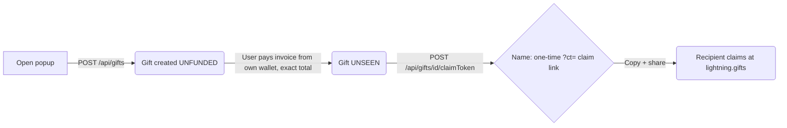

# Lightning Gifts — Chrome Extension

Operator-published Chrome extension for [lightning.gifts](https://lightning.gifts): send a
bitcoin gift to anyone, right from the browser.

**One clear job**: enter an amount and (optionally) a note → the extension creates the gift via
the lightning.gifts API → you pay the funding invoice **from your own Lightning wallet** →
you get back a single-use, time-limited claim link to hand the recipient.

The extension never holds funds, never sweeps, never pays — it only creates the gift and
copies the pieces you hand over.

## Diagram



## Install (Chrome)

**From source** (Chrome → `chrome://extensions` → Developer mode → Load unpacked):

```bash
git clone https://github.com/wahidmy/lightning-gifts-extension.git
```

store link pending review.

## Setup

1. Click the extension → **Connect your account**.
2. Sign in at lightning.gifts → **Profile → Developer API Keys** → **Create API key** → paste.
3. Treat the key like a password: it acts as your whole account with no scope and no expiry,
   and is revocable at any time from the same panel.

## Privacy & data

- Data goes **only** to `https://lightning.gifts` (`host_permissions` is pinned to that origin).
- The API key is stored in `chrome.storage.local` on your machine and sent only as a
  `Bearer` header on each call. No analytics, no telemetry, no logging beyond what
  lightning.gifts itself records per its [privacy policy](https://lightning.gifts/privacy).
- Claim links are single-use and **time-limited** — treat them like cash you handed over.

## Permission justifications (Chrome Web Store)

| Permission | Why |
|---|---|
| `storage` | Store the user's own API key locally so they don't retype it. |
| `clipboardWrite` | Enabled so "Copy invoice", "Copy link" work in the popup. |
| `host_permissions: https://lightning.gifts/*` | The app creates gifts and mints claim links through that site's documented API. |
| (no `scripts` content) | Extension runs entirely from its popup. |

## Runtime requirements

MV3, no service worker, no remote code — `manifest.json` + static assets + `popup.js`.

Actually, to be fair: MV3 **service worker** — this extension currently has none (all logic lives in
the popup). That's intentional: "no background workers" in the manifest is a smaller attack
surface for reviewers to audit.

## Licence

Blue Oak Model License 1.0.0 — [text in LICENSE](./LICENSE) /
<https://blueoakcouncil.org/license/1.0.0>.
